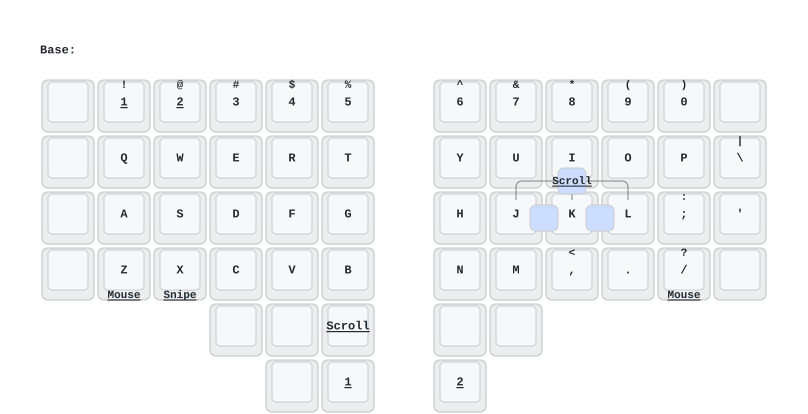
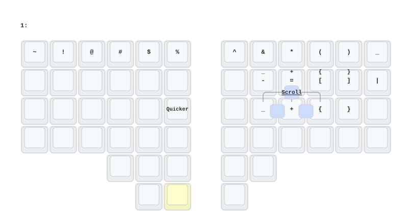
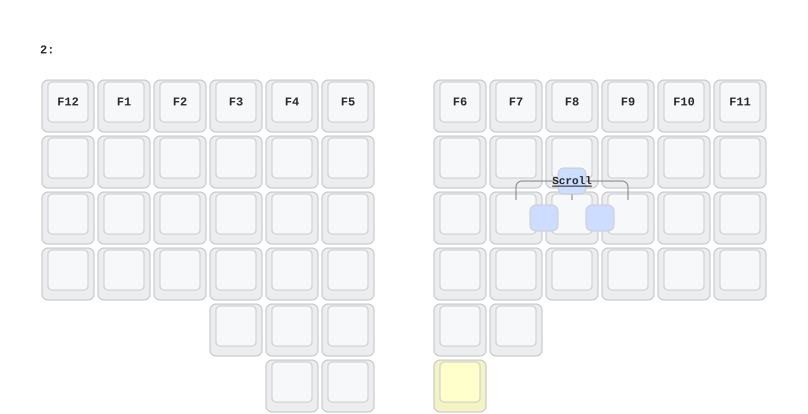
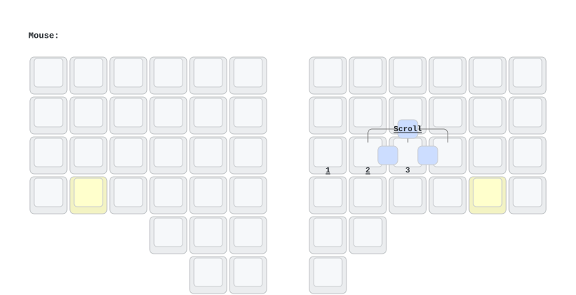

# zmk-config-charybdis

**English** · [简体中文](./README.md)

> **PMW3610 Trackball + DYA Studio + ZMK KeyTester**. Built on cormoran's ZMK
> `main+dya` fork with Zephyr 4.1, supporting live Trackball CPI, auto-mouse
> layer, scroll behavior, macros, and combos in DYA Studio, plus USB Raw HID
> physical matrix testing. The former `zmk-tester` branch has been promoted to
> `main`.

ZMK firmware configuration for the Charybdis 4×6 split trackball keyboard, with
[DYA Studio](https://studio.dya.cormoran.works/) support.

## About Charybdis

[Charybdis](https://github.com/Bastardkb/Charybdis/) is a split ergonomic
keyboard designed by Bastard Keyboards featuring curved keywells and an
integrated thumb trackball.

This configuration targets the **Charybdis 4×6** (56 keys) wireless split build:

- **4×6 main matrix + asymmetric thumb clusters** — 4 rows × 6 columns per half, with 5 thumb keys on the left and 3 thumb keys on the right
- **PMW3610 trackball on the right half** — connected over SPI to the right central half, defaulting to `800 CPI`
- **Split wireless** — a `nice!nano` (`pro_micro` footprint) in each half, paired over BLE
- **No display / no rotary encoders** — all pointer actions are handled by the right-half trackball and layers

## Firmware variants

Actions → latest build → Artifacts → `firmware` contains these `.uf2` files:

| Artifact | Description |
| --- | --- |
| `charybdis_right-nice_nano__zmk-zmk` | **Right half (central)** — PMW3610 trackball, DYA Studio, and KeyTester |
| `charybdis_left-nice_nano__zmk-zmk` | **Left half (peripheral)** — left-side matrix scan and relayed settings |
| `settings_reset-nice_nano__zmk-zmk` | Clear all persistent settings (including BLE bonds and DYA Studio config) |

Flash the matching file to each half. After `settings_reset`, flash a normal
firmware again.

### Studio unlock state

This firmware is **unlocked by default**:
`config/boards/shields/charybdis/charybdis_right.conf` sets
`CONFIG_ZMK_STUDIO_LOCKING=n`, so Studio stays unlocked after disconnecting and
Web Bluetooth / Web Serial can connect directly (the `&studio_unlock` combo has
also been removed from the keymap).

## Left / right assignment

**The central (main) half is the RIGHT one** — unlike left-central boards such
as Sofle, both USB and BLE live on the right half, and DYA Studio / ZMK
KeyTester only connect to the right half.

| | Right · central | Left · peripheral |
| --- | --- | --- |
| **Which firmware** | **`charybdis_right*`** | **`charybdis_left*`** |
| USB / BLE connection | Yes | — |
| PMW3610 trackball | Yes (SPI) | — |
| Studio communication | Yes | — |
| Connection mgmt, OS detection, OS layer switch | Yes | — |
| Settings relay | Originates | Receives and applies |
| Physical matrix tester (Raw HID) | Yes | Forwarded to right over split link |

This is defined in `config/boards/shields/charybdis/Kconfig.defconfig`
(`if SHIELD_CHARYBDIS_RIGHT → ZMK_SPLIT_BLE_ROLE_CENTRAL default y`).

> ⚠️ **Flashing left and right swapped leaves the whole keyboard unresponsive**
> (central and peripheral cannot pair and the trackball will not work).
> Remember: **the half with the trackball and USB = RIGHT = flash `charybdis_right*`**.

## Keymap

The diagrams below are generated by
[keymap-drawer](https://github.com/caksoylar/keymap-drawer) from
[`config/charybdis.keymap`](config/charybdis.keymap) and
[`config/charybdis.json`](config/charybdis.json), and automatically redrawn and
split per layer by
[`.github/workflows/keymap_drawer.yml`](.github/workflows/keymap_drawer.yml) on
keymap changes.

**Base (default layer)**



**Layer 1 (symbols & left-hand arrows)**



**Layer 2 (function keys, media & right-hand mods)**



**Mouse (mouse clicks, BLE & bootloader)** ([`Scroll`](keymap-drawer/layers/Scroll.svg) and [`Snipe`](keymap-drawer/layers/Snipe.svg) only switch trackball processing mode with all keys `&none`, omitted inline)



Full diagram (all 6 layers): [`keymap-drawer/charybdis.svg`](keymap-drawer/charybdis.svg)

## Layer design

| Layer | Activation | Contents |
| --- | --- | --- |
| 0 `Base` | — | QWERTY alpha/number block + thumb keys |
| 1 `layer_1` | Left lower-right thumb (`&mo 1`) | Shifted symbol top row (`~ ! @ # $ % ^ & * ( ) _`), left `ASDF` arrows (`← ↓ ↑ →`), `&quicker` macro on `G`, right symbols (`- = [ ] \| _ + { }`) |
| 2 `layer_2` | Right lower thumb (`&mo 2`) | `F1`–`F12`, left media keys (prev/play/next), left `ASDF` arrows, right volume/mute and home-row mods (`RSHFT RCTRL RALT RWIN`) |
| 3 `Mouse` | Auto-activated on trackball movement (`200ms`), or hold `Z` / `/` | Left thumb mouse buttons (`RCLK` / `LCLK` / `MCLK`), `&bootloader` on `T` / `Y`, `BT_CLR` on `U`, `BT_SEL 0/1/2` on `H J K` |
| 4 `Scroll` | Left inner upper thumb (`&mo 4`), or right home-row combo `J + K + L` | Turns trackball movement into scrolling (with axis snap) |
| 5 `Snipe` | Hold `X` (`&lt 5 X`) | Scales trackball movement by `1/2` for fine pointer control |
| 6–9 `extra1`–`extra4` | `reserved` layers | Reserved slots for adding layers directly in DYA Studio without reflashing |

Thumb cluster layout (5 left + 3 right):

```
Left thumbs                         Right thumbs
Top:     LGUI    SPACE   mo(Scroll) ENT     BSPC
Bottom:          LALT    mo(layer_1) mo(layer_2)
```

### Combos & hold-tap tuning

`config/charybdis.keymap` defines 3 right home-row mouse combos so you can click
or scroll one-handed while using the trackball:

- `J + K` (positions `31 + 32`) → Left click (`&mkp LCLK`)
- `K + L` (positions `32 + 33`) → Right click (`&mkp RCLK`)
- `J + K + L` (positions `31 + 32 + 33`) → Hold for `Scroll` layer (`&mo 4`)

Global hold-tap timing: `&lt` uses `tap-preferred` (`tapping-term-ms = 240`,
`quick-tap-ms = 150`, `require-prior-idle-ms = 10`); `&mt` uses `tap-preferred`
(`tapping-term-ms = 250`, `require-prior-idle-ms = 250`).

## Trackball & input processing

The right half integrates a **PMW3610** optical trackball sensor
(`cormoran,pmw3610`), configured in
[`config/boards/shields/charybdis/charybdis_right.conf`](config/boards/shields/charybdis/charybdis_right.conf)
and [`config/boards/shields/charybdis/charybdis_right.overlay`](config/boards/shields/charybdis/charybdis_right.overlay):

- **Hardware settings**: SPI0 (`SCK = P0.08`, `MOSI/MISO = P0.17` half-duplex, `CS = gpio0 20`, `IRQ = gpio0 6`), default `800 CPI`, with `SWAP_XY`, `INVERT_X`, `INVERT_Y`, and `SMART_ALGORITHM` enabled
- **Auto-mouse layer (`mouse_runtime_input_processor`)**: activates Layer 3 `Mouse` `200ms` after trackball motion begins and deactivates `400ms` after motion stops
- **Scroll mode (`scroll_runtime_input_processor`)**: converts XY motion into scroll events while Layer 4 `Scroll` is active, with `axis-snap-threshold = 100`
- **Snipe mode (`snipe`)**: applies `&zip_xy_scaler 1 2` while Layer 5 `Snipe` is active to halve pointer sensitivity

> All of these trackball parameters (CPI, orientation, auto-mouse delays, scroll
> scaling, axis snap, acceleration, etc.) are exposed in DYA Studio and saved
> persistently to settings without reflashing.

## DYA Studio

Open <https://studio.dya.cormoran.works/> in a browser and pick a connection
method on the splash page (connecting to the **right half**):

| Method | Description | Supported browsers |
| --- | --- | --- |
| USB | Pick a serial port after plugging in (Web Serial) | Chrome / Edge (desktop) |
| Bluetooth | Connect over BLE after pairing (Web Bluetooth) | Chrome / Edge (desktop), Android Chrome, iOS via Bluefy |
| Demo | Try every UI without a keyboard | same as above |

Firefox and Safari are not supported.

### Available features

- **Keymap Editor** — visual editor for layers 0–5 and reserved `extra1`–`extra4` with live key highlights
- **Macros & Combos** — create macros and combos on the web **without reflashing**
- **Trackball Tuning & Input Processors** — live tuning for PMW3610 CPI, orientation, auto-mouse layer timeouts, scroll scaling, and axis snap
- **Connection Management** — rename, switch, and clear BLE profiles; set USB vs BLE output preference
- **Device Settings** — OS detection (USB/BLE), per-OS default layer switching (0–5), idle / deep sleep timeouts (30 min default), split settings relay
- **Troubleshooting** — per-half battery levels & history, firmware version, uptime, watchdog status

> This keyboard has no EC11 rotary encoders, so DYA Studio's Sensor Rotate panel
> does not apply.

## ZMK KeyTester (physical matrix tester)

This repo integrates the
[tangbonze/zmk-matrix-tester](https://github.com/tangbonze/zmk-matrix-tester)
firmware module so you can run hardware-level physical matrix tests in
[ZMK KeyTester](https://github.com/tangbonze/zmk-keyboard-tester) without
enabling `CONFIG_ZMK_USB_LOGGING=y`.

1. Connect the **right half (central)** via USB cable (desktop Chrome / Edge).
2. Open the preloaded tester page:
   <https://tangbonze.github.io/zmk-keyboard-tester/?config=https://github.com/tangbonze/zmk-config-charybdis>
3. Click **WebHID Matrix** at the top and select your keyboard to light up any
   switch on either half, with optional silent intercept mode to prevent
   accidental keystrokes.

> Enabled by default in `Kconfig` for USB central (`HID_1`, `0xFF60 / 0x61`),
> without interfering with standard keyboard output, trackball, or BLE; zero
> code executes on battery power and deep sleep is unaffected.

## Local build

Requires the [Zephyr SDK](https://docs.zephyrproject.org/latest/develop/toolchains/index.html)
and [`west`](https://docs.zephyrproject.org/latest/develop/west/install.html).

Requires **Python 3.12** (Zephyr 4.1 does not support 3.13/3.14) and Zephyr SDK 0.17.0:

```bash
brew install python@3.12
python3.12 -m venv .venv && ./.venv/bin/pip install west
export ZEPHYR_SDK_INSTALL_DIR=~/zephyr-sdk-0.17.0

west init -l config
west update --narrow
west zephyr-export
# Studio's nanopb generator needs these two packages or proto generation fails
./.venv/bin/pip install "protobuf>=5.27" grpcio-tools

# Build right half (central, requires studio-rpc-usb-uart and CONFIG_ZMK_STUDIO=y)
west build -s zmk/app -d build/charybdis_right -b nice_nano//zmk -S studio-rpc-usb-uart -- \
  -DZMK_CONFIG="$PWD/config" -DSHIELD=charybdis_right -DCONFIG_ZMK_STUDIO=y

# Build left half (peripheral)
west build -s zmk/app -d build/charybdis_left -b nice_nano//zmk -- \
  -DZMK_CONFIG="$PWD/config" -DSHIELD=charybdis_left

# Build settings_reset
west build -s zmk/app -d build/settings_reset -b nice_nano//zmk -- \
  -DZMK_CONFIG="$PWD/config" -DSHIELD=settings_reset
```

Outputs land in `./build/<target>/zephyr/zmk.uf2`. If `west zmk-build` is
installed, you can also build all targets directly from `build.yaml`.

## Troubleshooting

A clean compile does not guarantee every feature is enabled. For instance, if
DYA Studio's Kconfig options aren't loaded, the firmware still builds and types,
but the Studio stack isn't linked — showing up as "cannot connect to Studio".

**1. Check the build log for Kconfig warnings.** Any `assigned the value 'y' but got 'n'`
means an unmet dependency for that symbol.

**2. Verify which `.conf` files were actually merged.** The right-half build log
should include:

- `config/boards/shields/charybdis/charybdis_right.conf`
- `config/charybdis.conf`
- `zmk/app/snippets/studio-rpc-usb-uart/studio-rpc-usb-uart.conf`

(Because `charybdis` is not in upstream ZMK's `app/boards/shields`, `.conf` files
under `config/boards/shields/charybdis/` are picked up directly.)

**3. Check the effective `.config`.** These symbols should all be `y` in
`build/charybdis_right/zephyr/.config` (especially `ZMK_BEHAVIOR_LOCAL_ID_TYPE_CRC16`,
which must match DYA Studio so Macros / Combos bind to the right keys):

```bash
grep -E "ZMK_STUDIO|PMW3610|PHYSICAL_LAYOUTS|WATCHDOG|OS_DETECTION|DEFAULT_LAYER|BLE_MANAGEMENT|RUNTIME_(MACRO|COMBO|INPUT)|DEVICE_INFO|LOCAL_ID_TYPE|ZMK_MATRIX_TESTER" \
  build/charybdis_right/zephyr/.config | grep -v "=n$"
```

**4. Trackball not responding** — make sure the right half is flashed with
`charybdis_right*`, and verify `CONFIG_PMW3610=y`, `CONFIG_SPI=y`, and
`CONFIG_ZMK_POINTING=y` in `.config`.

**5. Zephyr 4.1 BLE buffer requirement** — `config/charybdis.conf` sets
`CONFIG_BT_BUF_EVT_RX_COUNT=36` greater than `CONFIG_BT_BUF_ACL_TX_COUNT=32` to
satisfy Zephyr 4.1's Kconfig/build assertion.

**6. No input at all** — make sure you didn't flash them swapped: the half with
the trackball and USB plugged in must be `charybdis_right*`.

## Directory layout

```
config/
  charybdis.keymap       key definitions (6 active layers + 4 Studio reserved + 3 mouse combos)
  charybdis.json         layout description for external keymap-editor / KeyTester
                         (DYA Studio draws the keyboard from physical-layout in
                          charybdis-layouts.dtsi and charybdis_right.overlay)
  charybdis.conf         shared BLE and behavior queue settings for both halves
  west.yml               dependency manifest: ZMK fork + Zephyr 4.1 + PMW3610/DYA Studio + zmk-matrix-tester
  boards/shields/charybdis/
    Kconfig.defconfig    keyboard name (Charybdis), right-half central role, ZMK_SPLIT
    Kconfig.shield       shield identities (charybdis_left / charybdis_right)
    charybdis.zmk.yml    shield metadata (keys / pointer / studio)
    charybdis.dtsi       4×6 + thumb matrix transform and row pins
    charybdis-layouts.dtsi physical layout definition (charybdis_4x6_layout)
    charybdis_left.overlay left-half column pins
    charybdis_left.conf  left-half config (battery reporting, sleep, DYA settings relay)
    charybdis_right.overlay right-half column pins, PMW3610 SPI0 pins, runtime input processor pipeline
    charybdis_right.conf right-half config (PMW3610, full ZMK/DYA Studio RPC, battery history, sleep)
    charybdis.conf       reserved shield-level config
keymap-drawer/
  charybdis.yaml         parsed intermediate YAML generated by keymap-drawer
  charybdis.svg          combined 6-layer keymap diagram
  layers/                per-layer standalone SVGs embedded in the README
tools/
  split_keymap_svg.py    splits charybdis.svg into keymap-drawer/layers/*.svg
keymap_drawer.config.yaml keymap-drawer styling, icons, and keycode mapping config
.github/workflows/
  main.yml               calls cormoran/zmk build workflow for left, right, and settings_reset
  keymap_drawer.yml      redraws and splits keymap SVGs on keymap changes
build.yaml               build matrix (charybdis_left / charybdis_right + studio-rpc-usb-uart / settings_reset)
```

## Dependency source

This repo does not use upstream ZMK `main` / `v0.3`, but rather the `main+dya`
branch of [cormoran/zmk](https://github.com/cormoran/zmk) and its companion
modules (including `cormoran/zephyr` `v4.1.0+zmk-fixes+nrf-half-duplex-uart`
and [`zmk-driver-pmw3610-with-custom-studio-rpc`](https://github.com/cormoran/zmk-driver-pmw3610-with-custom-studio-rpc))
— adding the custom Studio RPC protocol, split relay, and runtime input
processing that DYA Studio relies on. **DYA Studio's extended features and live
trackball tuning depend on this fork**; switching back to upstream ZMK leaves
only basic keymap editing.

> ⚠️ cormoran's ZMK fork is an experimental branch tailored to DYA keyboards and
> may contain unstable changes; it is not recommended where high stability is
> required.

## License

MIT
