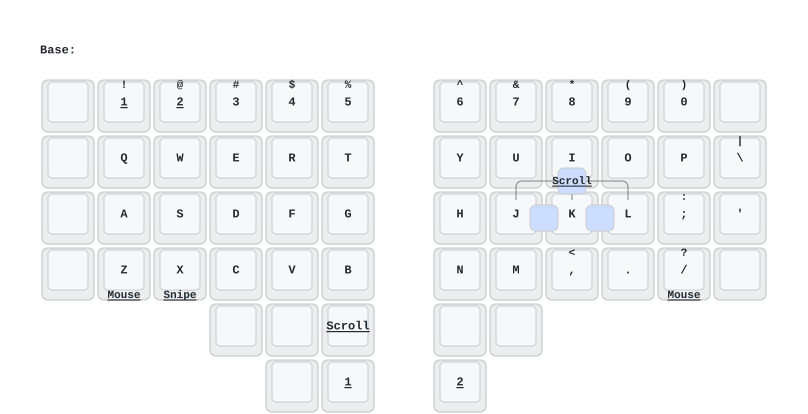
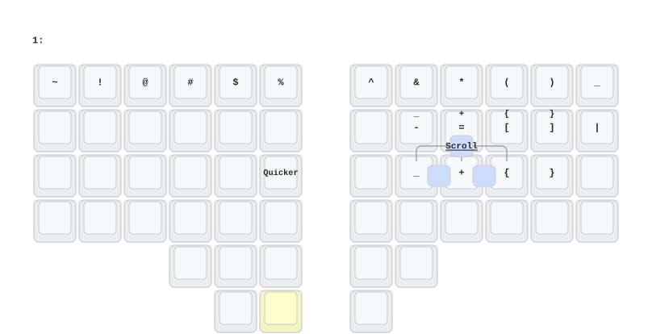
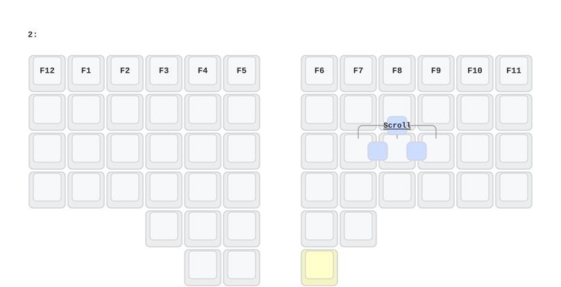
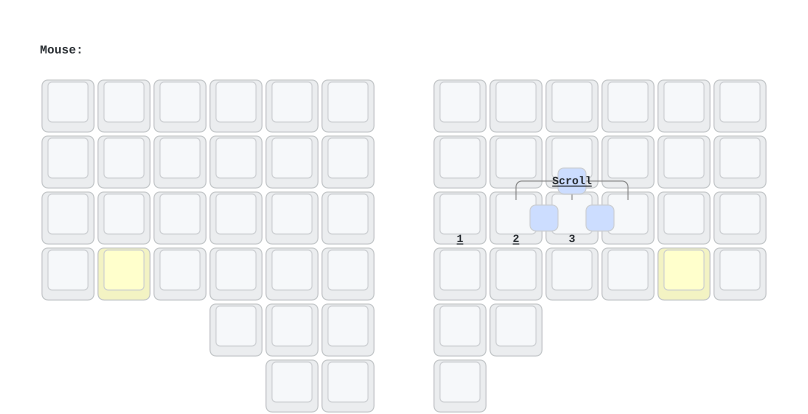

# zmk-config-charybdis

[English](./README.en.md) · **简体中文**

> **PMW3610 轨迹球 + DYA Studio + ZMK KeyTester**。使用 ZMK main + Zephyr 4.1
> 的 cormoran fork（`main+dya`），支持在 DYA Studio 中实时调节轨迹球 CPI、自动鼠标层、
> 滚轮映射、宏与组合键，并内置 USB Raw HID 物理矩阵测试。
> 原 `zmk-tester` 分支已合并为主分支 `main`。

Charybdis 4×6 分体轨迹球键盘的 ZMK 固件配置，已接入 [DYA Studio](https://studio.dya.cormoran.works/)。

## 关于 Charybdis

[Charybdis](https://github.com/Bastardkb/Charybdis/) 由 Bastard Keyboards 设计，
是一款带弧面键井（keywell）与拇指轨迹球的分体人体工学键盘。

本配置面向 **Charybdis 4×6**（共 56 键）无线双模构建：

- **4×6 主键区 + 不对称拇指簇** —— 左右各 4 行 × 6 列，左手 5 枚拇指键、右手 3 枚拇指键
- **右手集成 PMW3610 轨迹球** —— 通过 SPI 连接右手主控，默认 `800 CPI`
- **分体无线** —— 左右各一块 `nice!nano`（`pro_micro` 接口），通过 BLE 配对
- **无屏幕 / 无编码器** —— 全部指向操作由右手轨迹球与分层完成

## 固件变体

Actions → 最新一次构建 → Artifacts → `firmware`，内含以下 `.uf2`：

| Artifact | 说明 |
| --- | --- |
| `charybdis_right-nice_nano__zmk-zmk` | **右手（central 主控）**，含 PMW3610 轨迹球、DYA Studio 与 KeyTester |
| `charybdis_left-nice_nano__zmk-zmk` | **左手（peripheral 从控）**，负责左侧矩阵扫描与接收中继设置 |
| `settings_reset-nice_nano__zmk-zmk` | 清除所有持久化设置（含蓝牙配对与 DYA Studio 保存的配置） |

左右半分别刷对应文件。`settings_reset` 刷完后再刷正常固件即可。

### Studio 解锁状态

本仓库固件**默认处于 unlock（常开）状态**：`config/boards/shields/charybdis/charybdis_right.conf`
里设了 `CONFIG_ZMK_STUDIO_LOCKING=n`，断开连接后不会重新锁定，
Web Bluetooth / Web Serial 可以直接连上键盘改键位（因此 keymap 中也移除了 `&studio_unlock` 组合键）。

## 左右半分配

**本键盘的 central（主控）是右手** —— 与 Sofle 等左手主控键盘不同，USB 与 BLE 都接右手，
DYA Studio 和 ZMK KeyTester 也只会连上右手。

| | 右手 · central | 左手 · peripheral |
| --- | --- | --- |
| **刷哪个固件** | **`charybdis_right*`** | **`charybdis_left*`** |
| USB / BLE 连接 | 是 | — |
| PMW3610 轨迹球 | 是（SPI） | — |
| Studio 通信 | 是 | — |
| 连接管理、OS 识别、按 OS 切层 | 是 | — |
| 设置中继 | 发起 | 接收并应用 |
| 物理矩阵测试（Raw HID） | 是 | 经分体链路汇总到右手上报 |

这由 `config/boards/shields/charybdis/Kconfig.defconfig` 定义（`if SHIELD_CHARYBDIS_RIGHT → ZMK_SPLIT_BLE_ROLE_CENTRAL default y`）。

> ⚠️ **刷反了整把键盘会完全没有输入**（central 与 peripheral 配不上，轨迹球也无法工作）。
> 记住：**带轨迹球、插 USB 的那一半 = 右手 = 刷 `charybdis_right*`**。

## Keymap

以下键位图由 [keymap-drawer](https://github.com/caksoylar/keymap-drawer) 根据
[`config/charybdis.keymap`](config/charybdis.keymap) 与 [`config/charybdis.json`](config/charybdis.json)
自动生成，并由 [`.github/workflows/keymap_drawer.yml`](.github/workflows/keymap_drawer.yml)
在修改键位后自动更新与按层拆分。

**Base（默认层）**



**Layer 1（符号 / 左手方向层）**



**Layer 2（F 键 / 媒体 / 右手修饰层）**



**Mouse（鼠标 / 蓝牙 / Bootloader 层）**（[`Scroll`](keymap-drawer/layers/Scroll.svg) 与 [`Snipe`](keymap-drawer/layers/Snipe.svg) 层仅用于切换轨迹球滚轮/降速处理链，其余键位为 `&none`，此处不单列）



完整图（含全部 6 层）：[`keymap-drawer/charybdis.svg`](keymap-drawer/charybdis.svg)

## 图层设计

| 层 | 进入方式 | 内容 |
| --- | --- | --- |
| 0 `Base` | — | QWERTY 主键区 + 拇指常用键 |
| 1 `layer_1` | 左手下排右侧拇指键（`&mo 1`） | 顶部数字行改符号（`~ ! @ # $ % ^ & * ( ) _`）、左手 `ASDF` 方向键（`← ↓ ↑ →`）、`G` 键 `&quicker` 宏、右手符号（`- = [ ] \| _ + { }`） |
| 2 `layer_2` | 右手下排拇指键（`&mo 2`） | `F1`–`F12`、左侧媒体控制（上一曲/播放/下一曲）、左手 `ASDF` 方向键、右侧音量/静音与 Home-Row 修饰键（`RSHFT RCTRL RALT RWIN`） |
| 3 `Mouse` | 滑动轨迹球自动触发（`200ms`），或长按 `Z` / `/` | 左手拇指区鼠标键（`RCLK` / `LCLK` / `MCLK`）、`T` / `Y` 为 `&bootloader`、`U` 为 `BT_CLR`、`H J K` 为 `BT_SEL 0/1/2` |
| 4 `Scroll` | 左手内侧上排拇指键（`&mo 4`），或右手中排 `J + K + L` 组合键 | 轨迹球转为滚轮模式（支持方向轴吸附） |
| 5 `Snipe` | 长按 `X`（`&lt 5 X`） | 轨迹球速度缩放为 `1/2`，用于精细移动光标 |
| 6–9 `extra1`–`extra4` | 预留层（`reserved`） | 供 DYA Studio 在网页端直接新增图层，无需重编固件 |

拇指键布局（左手 5 枚、右手 3 枚）：

```
左半拇指                            右半拇指
上排:  LGUI    SPACE   mo(Scroll)   ENT     BSPC
下排:          LALT    mo(layer_1)  mo(layer_2)
```

### 组合键（Combos）与点击判定

`config/charybdis.keymap` 内置 3 组右手中排快捷鼠标操作，在单手控制轨迹球时无需左手即可点击或滚屏：

- `J + K`（键位 `31 + 32`）→ 鼠标左键（`&mkp LCLK`）
- `K + L`（键位 `32 + 33`）→ 鼠标右键（`&mkp RCLK`）
- `J + K + L`（键位 `31 + 32 + 33`）→ 按住进入 `Scroll` 层（`&mo 4`）

Hold-Tap 全局时序：`&lt` 采用 `tap-preferred`（`tapping-term-ms = 240`、`quick-tap-ms = 150`、`require-prior-idle-ms = 10`）；
`&mt` 采用 `tap-preferred`（`tapping-term-ms = 250`、`require-prior-idle-ms = 250`）。

## 轨迹球与输入处理

右手集成 **PMW3610** 光学轨迹球传感器（`cormoran,pmw3610` 驱动），默认配置位于
[`config/boards/shields/charybdis/charybdis_right.conf`](config/boards/shields/charybdis/charybdis_right.conf)
与 [`config/boards/shields/charybdis/charybdis_right.overlay`](config/boards/shields/charybdis/charybdis_right.overlay)：

- **硬件参数**：SPI0（`SCK = P0.08`、`MOSI/MISO = P0.17` 半双工、`CS = gpio0 20`、`IRQ = gpio0 6`），默认 `800 CPI`，已开启 `SWAP_XY`、`INVERT_X`、`INVERT_Y` 与智能休眠算法（`SMART_ALGORITHM`）
- **自动鼠标层（`mouse_runtime_input_processor`）**：移动轨迹球后延时 `200ms` 自动切入 Layer 3 `Mouse`，停止移动 `400ms` 后退出
- **滚轮层（`scroll_runtime_input_processor`）**：在 Layer 4 `Scroll` 激活时将 XY 位移转为滚轮事件，默认 `axis-snap-threshold = 100`
- **狙击模式（`snipe`）**：在 Layer 5 `Snipe` 通过 `&zip_xy_scaler 1 2` 将移动灵敏度减半

> 以上轨迹球参数（CPI、自动鼠标层延迟、滚轮轴吸附与加速度曲线等）均已接入 DYA Studio，
> 可直接在网页端修改并写入 settings 持久化保存，无需重新编译固件。

## DYA Studio

浏览器打开 <https://studio.dya.cormoran.works/>，按 splash 页面选择连接方式（连接**右手**）：

| 方式 | 说明 | 支持的浏览器 |
| --- | --- | --- |
| USB | 插线后选择串口（Web Serial） | Chrome / Edge（桌面） |
| Bluetooth | 配对后通过 BLE 连接（Web Bluetooth） | Chrome / Edge（桌面）、Android Chrome、iOS 用 Bluefy |
| Demo | 无需键盘，模拟键盘试用全部界面 | 同上 |

Firefox 与 Safari 不支持。

### 可用功能

- **Keymap Editor** — 可视化编辑 0–5 层与预留层 `extra1`–`extra4`，按键实时高亮
- **Macros & Combos** — 网页上直接创建宏与组合键，**无需重新编译固件**
- **Trackball Tuning & Input Processors** — 实时调节 PMW3610 CPI、方向、自动鼠标层超时、滚轮缩放与轴吸附等参数
- **Connection Management** — BLE 配置档重命名 / 切换 / 解绑，设置 USB 与蓝牙优先级
- **Device Settings** — OS 识别（USB/BLE）、按 OS 自动切换默认层（0–5）、idle / deep sleep 超时（默认 30 分钟）、双半设置中继
- **Troubleshooting** — 双半电量与电池历史、固件版本、uptime、看门狗状态

> 本键盘没有 EC11 旋转编码器，因此 DYA Studio 的 Sensor Rotate 面板不适用。

## ZMK KeyTester（物理矩阵测试）

本仓库已集成 [tangbonze/zmk-matrix-tester](https://github.com/tangbonze/zmk-matrix-tester)
固件模块，配合 [ZMK KeyTester](https://github.com/tangbonze/zmk-keyboard-tester)
网页端可进行硬件级物理矩阵直读测试（无需开启 `CONFIG_ZMK_USB_LOGGING=y`）。

1. 将**右手（central）**通过 USB 数据线连接到电脑（需桌面版 Chrome / Edge）。
2. 打开预载本仓库配置的在线测试页：
   <https://tangbonze.github.io/zmk-keyboard-tester/?config=https://github.com/tangbonze/zmk-config-charybdis>
3. 点击顶部 **「WebHID 物理矩阵」**，选择你的键盘即可直接点亮左右手任意物理轴体，并支持静默拦截模式防误触。

> 该模块在 `Kconfig` 中对 USB central 端默认开启（`HID_1`，`0xFF60 / 0x61`），
> 不干扰标准键盘输出、轨迹球与蓝牙；拔掉 USB 使用电池时零代码执行、不影响深度休眠。

## 本地构建

需要 [Zephyr SDK](https://docs.zephyrproject.org/latest/develop/toolchains/index.html) 和
[`west`](https://docs.zephyrproject.org/latest/develop/west/install.html)。

需要 **Python 3.12**（Zephyr 4.1 不支持 3.13/3.14）和 Zephyr SDK 0.17.0：

```bash
brew install python@3.12
python3.12 -m venv .venv && ./.venv/bin/pip install west
export ZEPHYR_SDK_INSTALL_DIR=~/zephyr-sdk-0.17.0

west init -l config
west update --narrow
west zephyr-export
# Studio 的 nanopb 生成器需要这两个包，否则构建会在生成 proto 时失败
./.venv/bin/pip install "protobuf>=5.27" grpcio-tools

# 构建右手（central，需带 studio-rpc-usb-uart 与 CONFIG_ZMK_STUDIO=y）
west build -s zmk/app -d build/charybdis_right -b nice_nano//zmk -S studio-rpc-usb-uart -- \
  -DZMK_CONFIG="$PWD/config" -DSHIELD=charybdis_right -DCONFIG_ZMK_STUDIO=y

# 构建左手（peripheral）
west build -s zmk/app -d build/charybdis_left -b nice_nano//zmk -- \
  -DZMK_CONFIG="$PWD/config" -DSHIELD=charybdis_left

# 构建 settings_reset
west build -s zmk/app -d build/settings_reset -b nice_nano//zmk -- \
  -DZMK_CONFIG="$PWD/config" -DSHIELD=settings_reset
```

固件输出在 `./build/<target>/zephyr/zmk.uf2`。若已配置 `west zmk-build` 扩展命令，也可直接按 `build.yaml` 批量构建。

## 排查

固件能编译通过不代表功能都打开了。例如 DYA Studio 的 Kconfig 若未正确加载，
固件仍能刷入打字，但 Studio 协议栈不会被链接进去，表现为"连不上 Studio"。

**1. 先看构建日志里的 Kconfig warning。** 若出现 `assigned the value 'y' but got 'n'`，
说明对应符号的依赖未满足（可对照构建输出中的 `Merged configuration` 列表）。

**2. 确认构建实际合并了哪些 `.conf`。** 右手构建日志中应能看到：

- `config/boards/shields/charybdis/charybdis_right.conf`
- `config/charybdis.conf`
- `zmk/app/snippets/studio-rpc-usb-uart/studio-rpc-usb-uart.conf`

（因为 `charybdis` 不在 ZMK 官方 `app/boards/shields` 内，放在仓库 `config/boards/shields/charybdis/` 下的 `.conf` 会被正常读取。）

**3. 核对最终生效的 `.config`。** 下面这些在 `build/charybdis_right/zephyr/.config` 中应为 `y`
（尤其是 `ZMK_BEHAVIOR_LOCAL_ID_TYPE_CRC16`，必须与 DYA Studio 一致，否则 Macros / Combos 写入会错位）：

```bash
grep -E "ZMK_STUDIO|PMW3610|PHYSICAL_LAYOUTS|WATCHDOG|OS_DETECTION|DEFAULT_LAYER|BLE_MANAGEMENT|RUNTIME_(MACRO|COMBO|INPUT)|DEVICE_INFO|LOCAL_ID_TYPE|ZMK_MATRIX_TESTER" \
  build/charybdis_right/zephyr/.config | grep -v "=n$"
```

**4. 轨迹球没反应**，确认右手刷的是 `charybdis_right*`，且 `.config` 中 `CONFIG_PMW3610=y`、
`CONFIG_SPI=y`、`CONFIG_ZMK_POINTING=y`。

**5. Zephyr 4.1 蓝牙缓冲要求**，`config/charybdis.conf` 已设置
`CONFIG_BT_BUF_EVT_RX_COUNT=36` 大于 `CONFIG_BT_BUF_ACL_TX_COUNT=32`，避免构建断言失败。

**6. 键盘完全没有输入**，先确认没刷反：插 USB 与带轨迹球的那半必须是 `charybdis_right*`。

## 目录结构

```
config/
  charybdis.keymap       键位定义（6 层实装 + 4 个 Studio 预留层 + 3 个鼠标组合键）
  charybdis.json         外部 keymap-editor / KeyTester 用的布局描述
                         （DYA Studio 的键盘图形来自 charybdis-layouts.dtsi 与
                          charybdis_right.overlay 中的 physical-layout）
  charybdis.conf         两半共用的蓝牙与行为队列配置
  west.yml               依赖清单：ZMK fork + Zephyr 4.1 + PMW3610/DYA Studio 模块 + zmk-matrix-tester
  boards/shields/charybdis/
    Kconfig.defconfig    键盘名（Charybdis）、右手 central 角色、ZMK_SPLIT
    Kconfig.shield       shield 标识（charybdis_left / charybdis_right）
    charybdis.zmk.yml    shield 元数据（keys / pointer / studio）
    charybdis.dtsi       4×6+拇指矩阵变换与行引脚定义
    charybdis-layouts.dtsi 物理布局定义（charybdis_4x6_layout）
    charybdis_left.overlay 左手列引脚定义
    charybdis_left.conf  左手配置（电量上报、休眠、DYA 设置中继接收）
    charybdis_right.overlay 右手列引脚、PMW3610 SPI0 引脚与 runtime input processor 管线
    charybdis_right.conf 右手配置（PMW3610、ZMK/DYA Studio 全套 RPC、电量历史、休眠）
    charybdis.conf       预留 shield 级配置
keymap-drawer/
  charybdis.yaml         keymap-drawer 解析出的中间键位数据
  charybdis.svg          完整 6 层键位总图
  layers/                按层拆分的独立 SVG（供 README 嵌入展示）
tools/
  split_keymap_svg.py    将 charybdis.svg 按层拆分为 keymap-drawer/layers/*.svg
keymap_drawer.config.yaml keymap-drawer 样式、图标与键名映射配置
.github/workflows/
  main.yml               调用 cormoran/zmk 构建工作流编译左右手与 settings_reset 固件
  keymap_drawer.yml      键位变更后自动重绘并拆分 keymap SVG
build.yaml               构建矩阵（charybdis_left / charybdis_right + studio-rpc-usb-uart / settings_reset）
```

## 依赖来源

本仓库不使用 ZMK 官方 `main` / `v0.3`，而是 [cormoran/zmk](https://github.com/cormoran/zmk)
的 `main+dya` 分支及对应模块（含 `cormoran/zephyr` `v4.1.0+zmk-fixes+nrf-half-duplex-uart` 与
[`zmk-driver-pmw3610-with-custom-studio-rpc`](https://github.com/cormoran/zmk-driver-pmw3610-with-custom-studio-rpc)）——
它在 ZMK main 之上增加了 DYA Studio 所需的自定义 Studio RPC 协议、分体中继与运行时输入处理支持。
**DYA Studio 的扩展功能与轨迹球在线调参依赖这个 fork**，换回官方 ZMK 只能保留基础的 keymap 编辑功能。

> ⚠️ cormoran 的 ZMK fork 为实验性分支，针对 DYA 键盘优化，可能包含不稳定的变更，
> 不建议用于对稳定性要求极高的生产场景。

## License

MIT
